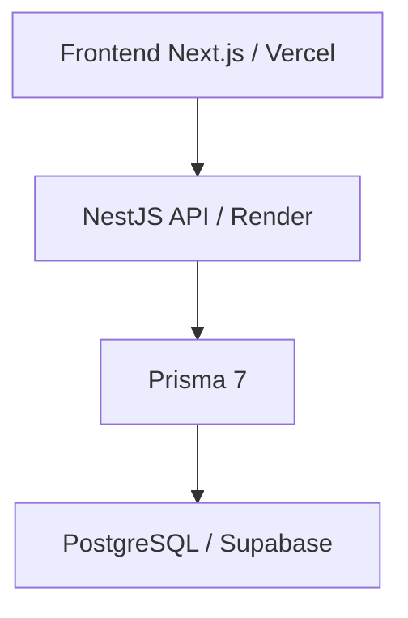
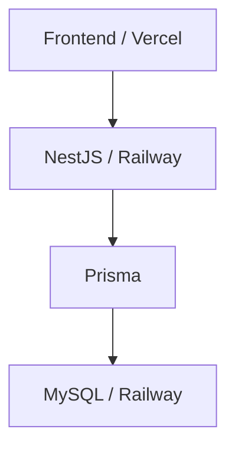

# Fase 2 — arquitetura e ambientes

Referência: 20/10/2026. Tarefa `86e39wfaq`. Este documento define a arquitetura;
não provisiona serviços nem comprova disponibilidade contínua dos ambientes.

## Ambientes e estado dos componentes

| Componente | Desenvolvimento | Homologação da Fase 2 | Produção |
| --- | --- | --- | --- |
| Frontend Next.js | Local; previews na Vercel quando configurados | Vercel | MVP publicado na Vercel em [clubevalhalla.vercel.app](https://clubevalhalla.vercel.app/) |
| API NestJS | Local com banco isolado | Render Free, ambiente provisionado | Railway planejado; ainda não implantado |
| Banco | PostgreSQL isolado, local ou hospedado | PostgreSQL hospedado no Supabase Free; migration inicial aplicada | MySQL no Railway planejado; migração ainda não aprovada para execução |
| Prisma 7 | Integrado à API, client gerado no build | Provider PostgreSQL e adapter `PrismaPg` | Exigirá provider, adapter e migrations compatíveis com MySQL |
| Domínio base | Campaign, Session e OneShot implementados | Requer validação funcional a cada release | Sem declaração de produção autenticada |
| Logging / Request ID | Implementados | Disponíveis no código; exportação/retenção operacional a confirmar | Estratégia de coleta a validar |
| Autenticação/JWT | Não implementada | Rotas privadas falham fechadas | Não disponível |
| Métricas consolidadas | Definidas para coleta | Sem baseline neste repositório | Dimensionamento pendente |

A publicação do MVP é independente da API: a landing atual usa conteúdo estático.
O schema também modela funcionalidades ainda sem implementação de aplicação,
como feedbacks, reports, disciplina e audit log. Modelo persistente não significa
fluxo de produto entregue. O estado da migration em homologação é o registrado
na [documentação de banco](../database/prisma-postgresql-e-portabilidade-mysql.md),
não uma nova consulta ao banco nesta revisão.

## Fluxo de requisição e fronteiras

Homologação: fluxo da integração da Fase 2, quando o frontend consumir a API.

Produção planejada, ainda não implantada:

O navegador acessa somente a API para operações de domínio, nunca o banco ou
credenciais Prisma. Next.js responde pela apresentação. NestJS valida entrada,
autorização, regras de negócio e transações; Prisma realiza a persistência.
Banco e serviços de hosting não substituem a autorização da API.

`request.user.id` é apenas o contrato esperado da futura infraestrutura confiável
de autenticação. Hoje, sem esse contexto, rotas privadas retornam
`401 USER_CONTEXT_REQUIRED`; `x-user-id` não autentica. ADMIN/DEV de sistema exigem
conta aprovada; papéis de clube não concedem acesso administrativo por si sós.
Ver [contrato de mesas](../api/tables-domain.md).

## Responsabilidades e dependências externas

| Serviço | Responsabilidade | Limite da decisão |
| --- | --- | --- |
| Vercel | Build, entrega do Next.js e variáveis do frontend | Não hospeda a persistência do domínio nesta arquitetura |
| Render Free | Execução da API de homologação e suas variáveis | Capacidade e comportamento de suspensão/cold start devem ser medidos, sem promessa de SLA |
| Supabase Free | PostgreSQL hospedado de homologação | Não usar Supabase Auth como fundação da autenticação; Realtime, Edge Functions, Storage e RLS exigem nova decisão |
| Railway | Destino planejado de API, MySQL e secrets de produção | Adoção condicionada a homologação, métricas, custo vigente e ensaio de migração |
| GitHub e registro npm | Versionamento, revisão e obtenção de dependências de build | Manter lockfiles e acesso restrito; não armazenar secrets em issues/PRs |

WhatsApp e canais sociais são links externos da landing; não são provedores de
identidade. Supabase é tratado como PostgreSQL hospedado. Regras de negócio
permanecem na API NestJS, sem dependência implícita de produtos adicionais.

## Desenvolvimento e homologação

O [setup local](../setup-local.md) usa aplicações separadas em `apps/web` e
`apps/api`, sem workspace npm na raiz. Desenvolvedores usam banco isolado e
dados sintéticos; não reutilizam a credencial de homologação para criar migrations.
Previews não devem receber secrets de produção ou acessar dados reais por padrão.

Homologação integra frontend Vercel, API Render Free e PostgreSQL Supabase Free.
Cada release deve identificar commit, ambiente e migration, validar `/health`,
conectividade, rotas públicas e o fechamento das rotas privadas sem autenticação.
URLs de API, configuração de origens/CORS e integração ponta a ponta precisam
ser conferidas no ambiente; variáveis reservadas não significam integração pronta.

## Prisma, migrations e portabilidade

O provider atual é PostgreSQL. `PrismaModule`/`PrismaService` abrem e encerram a
conexão com o ciclo da API. SQL e migrations PostgreSQL não são reutilizáveis
automaticamente no MySQL. Os IDs atuais usam `cuid()` e devem ser preservados.

Desenvolvimento cria migrations apenas em banco isolado. Homologação aplica
somente migrations versionadas e revisadas. Nunca usar `db push` ou
`migrate dev` em homologação/produção. Validar backup e restauração antes de
mudanças de dados; esta PR não executa migrations. Scripts e fluxo canônico:
[Prisma e PostgreSQL](../database/prisma-postgresql-e-portabilidade-mysql.md).

Para uma futura migração, revisar tipos, Decimal, JSON, enums, collation,
unicidade, datas, índices, constraints e comportamento transacional; evitar
dependências específicas sem justificativa e alternativa testável. Criar histórico
MySQL próprio em mudança separada, ajustar provider/adapter/client, ensaiar ETL
com dados protegidos, validar contagens, IDs, relações e invariantes de negócio,
testar integração, definir janela de corte e rollback com backup restaurável.
Não alterar apenas `DATABASE_URL`. Diretrizes detalhadas:
[portabilidade PostgreSQL → MySQL](../database/portabilidade-postgresql-mysql.md).

## Secrets e variáveis por aplicação

`.env`/`.env.local` existem somente localmente, fora do Git. `.env.example`
contém nomes e exemplos seguros, nunca credenciais reais. Vercel administra
variáveis do frontend; Render administra secrets da API em homologação;
Railway deverá administrar os da futura produção. Cada ambiente usa credenciais
próprias, com menor privilégio e acesso limitado aos responsáveis autorizados.

Inventário baseado nos exemplos e consumidores atuais, **somente nomes**:

| Aplicação | Nome | Uso/estado atual |
| --- | --- | --- |
| Web | `SITE_URL` | Consumida em metadata, canonical, Open Graph e JSON-LD |
| Web / plataforma | `VERCEL_PROJECT_PRODUCTION_URL` | Fallback consumido pelo layout; variável fornecida pela Vercel, ausente do exemplo local |
| Web | `NEXT_PUBLIC_API_URL` | Reservada; landing não consome API em runtime |
| Web | `NEXT_PUBLIC_APP_NAME` | Reservada no exemplo |
| Web | `NEXT_PUBLIC_APP_ENV` | Reservada no exemplo |
| API | `PORT` | Porta de escuta |
| API | `NODE_ENV` | Contexto de execução; presente no exemplo |
| API | `DATABASE_URL` | Conexão Prisma/PostgreSQL; secret obrigatório para iniciar API |
| API | `JWT_SECRET` | Reservada; JWT não implementado |
| API | `JWT_EXPIRES_IN` | Reservada; JWT não implementado |
| API | `FRONTEND_URL` | Reservada para integração |
| API | `CORS_ORIGIN` | Reservada; não implica CORS configurado no código |

Variáveis `NEXT_PUBLIC_*` são públicas: nunca colocar segredo nelas. Não registrar
secrets em PR, ClickUp, documentação ou logs, inclusive dumps de ambiente e URLs
de conexão. Solicitar acesso por canal privado autorizado. Rotação deve ocorrer
pela configuração do ambiente, sem alterar código: trocar a credencial, aplicar
restart/redeploy quando necessário, validar funcionamento e revogar a anterior.
Rotação de chaves de autenticação exigirá procedimento próprio quando implementada.

## Riscos e critérios de decisão

| Risco | Evidência necessária / mitigação |
| --- | --- |
| Recursos gratuitos variáveis, suspensão e cold starts | Medir latência, falhas e reinícios com janela e fonte; não inferir capacidade a partir do nome do plano |
| Diferença PostgreSQL/MySQL | Ensaio de migração, integração MySQL e restauração antes de aprovar corte |
| Pool de conexões, rede e distância entre provedores | Medir conexões/latência; validar modo de conexão e orçamento por instância antes de escalar |
| Secrets ou dados disciplinares expostos | Minimização, controle de acesso e [privacidade](../privacy/lgpd-fase2.md) |
| Visibilidade insuficiente e perdas de logs | Registrar cobertura e lacunas no [relatório de capacidade](../observability/metricas-capacidade-fase2.md) |
| Confundir schema e funcionalidades prontas | Manter [roadmap](../mvp.md) separado do inventário de implementação |

Manter Render/Supabase temporários enquanto a homologação atender aos critérios
de aceite aprovados e houver margem medida de recursos, operação e recuperação.
Otimizar primeiro quando a evidência apontar consultas, índices, payloads ou pool
como gargalo. Avaliar Railway quando limitações recorrentes prejudicarem a
homologação, requisitos operacionais não forem atendidos ou a produção autenticada
estiver pronta para avaliação. A decisão exige baseline, metas aprovadas, custos
vigentes, responsável, ensaio e rollback; não há gatilho numérico inventado.

Pendências operacionais: baseline e metas de capacidade, orçamento, validação de
backup/restauração, acesso aos painéis/logs e ensaio MySQL. Essas atividades não
foram executadas por esta consolidação documental.
